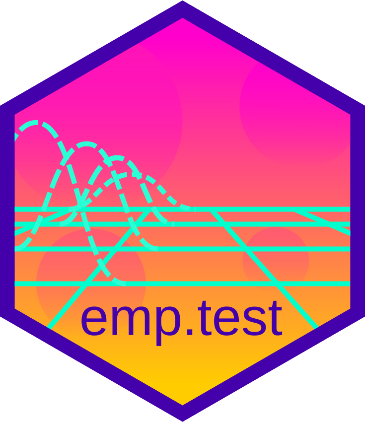

# emp.test package

## Overview

`emp.test` implements empirical statistical tests using bootstrapping:

- location tests, like Student's one-sample t-test.
- difference tests, like Student's two-sample t-test.
- equivalence (incl. non-inferiority and non-superiority) tests.
- goodness-of-fit tests, like Fisher's Chi-Square test.

This package is currently under development. 

## Installing emp.test

Future versions of emp.test will be installable from CRAN.

    install.packages("emp.test")

The current version can be installed from GitHub:

    remotes::install_github("alexzwanenburg/emp.test/package")
